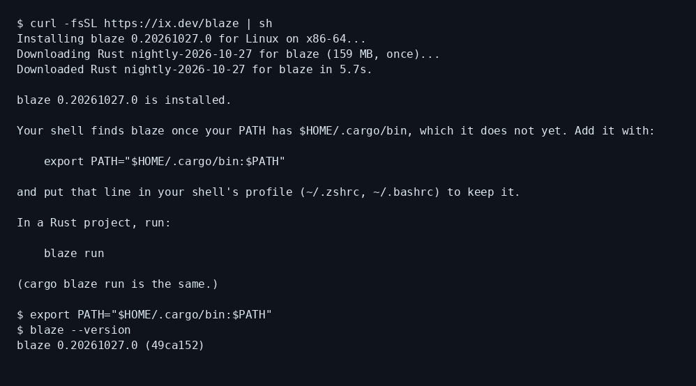
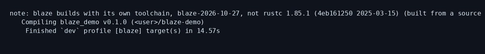
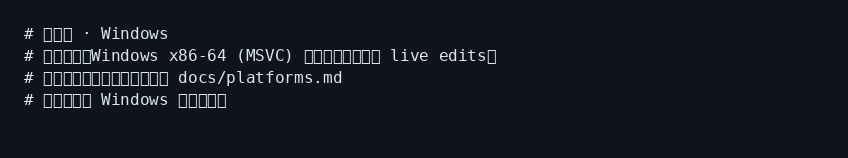

# blaze 小白中文教程

> Rust 毫秒级增量编译工具入门（社区非官方教程）  
> 上游：[`indexable-inc/blaze`](https://github.com/indexable-inc/blaze) · 官网：[ix.dev/blaze](https://ix.dev/blaze)  
> 教程校对日期：2026-10-28（Asia/Shanghai）· 本机 Linux x86_64 实测 **blaze 0.20261027.0**

[](https://github.com/xianyu110/awesome-blaze-zh)
[](https://github.com/indexable-inc/blaze)
[](LICENSE)
[](https://xianyu110.github.io/awesome-blaze-zh/)

---

## 截图索引

| # | 文件 | 类型 | 说明 |
|---|------|------|------|
| 1 | [`images/01-install.png`](images/01-install.png) | **真实** | `curl … \| sh` 安装（含 toolchain 下载） |
| 2 | [`images/03-build-first.png`](images/03-build-first.png) | **真实** | 首次 `blaze build`（`[blaze]`） |
| 3 | [`images/04-build-incremental.png`](images/04-build-incremental.png) | **真实** | 改代码后再 build（约 0.12s） |
| 4 | [`images/05-run.png`](images/05-run.png) | **真实** | `blaze run` 输出 |
| 5 | [`images/06-windows-schematic.png`](images/06-windows-schematic.png) | **示意图** | Windows MSVC 现状（无官方安装器） |

> 真实截图在 Linux x86_64 沙盒采集；路径已脱敏。版本号以你安装时官方最新 release 为准。

---

## 这是什么？

**blaze**（ix / indexable-inc）让你用接近 `cargo` 的命令获得**毫秒级增量重建**：

- 安装：`curl -fsSL https://ix.dev/blaze | sh`
- 日常：`blaze build` / `blaze run` / `blaze test`（也可 `cargo blaze …`）
- 自带 toolchain（本教程实测：`blaze-2026-10-27` / nightly-2026-10-27，约 125–160 MB，装一次）
- 改函数后再 build，日志里会出现 **`[blaze]`**
- **年轻项目**：请继续以 `cargo check` / CI 为最终准绳

本仓库只提供**中文小白教程**（MIT），不二次分发上游二进制。

---

## 官方链接（请以官方为准）

| 资源 | 链接 |
|------|------|
| 官网 / 安装页 | https://ix.dev/blaze |
| 源码 | https://github.com/indexable-inc/blaze |
| 安装说明 | https://github.com/indexable-inc/blaze/blob/main/docs/install.md |
| 平台现状 | https://github.com/indexable-inc/blaze/blob/main/docs/platforms.md |
| 用法 / 限制 | https://github.com/indexable-inc/blaze/blob/main/docs/usage.md |
| Toolchain 说明 | https://github.com/indexable-inc/blaze/blob/main/docs/toolchain.md |

---

## 平台支持（摘要）

| 平台 | 状态（摘自官方） |
|------|------------------|
| **Apple Silicon macOS** | 一等公民；有安装器 |
| **Linux**（x86_64 / ARM64） | 一等公民；有安装器 |
| **Windows x86-64 MSVC** | 可手跑构建与 live edits；**尚无安装器、无 sandbox**；细节见 `docs/platforms.md` |
| `x86_64-apple-darwin` | 官方拒绝（Intel Mac 不在支持路径） |

---

## 安装（macOS / Linux）

```bash
curl -fsSL https://ix.dev/blaze | sh
# 可选：先不下载 toolchain，首次 build 再下
# curl -fsSL https://ix.dev/blaze | sh -s -- --no-toolchain
```

确保 `~/.cargo/bin` 在 PATH：

```bash
export PATH="$HOME/.cargo/bin:$PATH"
# 写入 ~/.bashrc 或 ~/.zshrc 以便持久
```

本机真实安装日志：



其他安装方式（crates.io、Nix 等）见官方 `docs/install.md`。

---

## 第一次演示任务（约 5 分钟）

在任意 Rust 项目里：

```bash
cargo new blaze_demo && cd blaze_demo
blaze build    # 首次会较慢（加载工程 / 拉 toolchain）
# 改 src/main.rs 后再：
blaze build    # 应明显更快，Finished 行带 [blaze]
blaze run
blaze test
```

本机 Linux 真实截图：




```text
$ blaze build          # first
Finished `dev` profile [blaze] target(s) in 14.57s

$ blaze build          # after touch/edit
Finished `dev` profile [blaze] target(s) in 0.12s

$ blaze run
hello again after edit
```

---

## Windows 说明（示意图）

官方：Windows MSVC 可构建并做 live edits，但**目前没有安装器**，需按 `docs/platforms.md` 自行准备环境；不要假设有和 macOS/Linux 一样的 `curl | sh`。



---

## 常见报错与处理

| 现象 | 可能原因 | 处理 |
|------|----------|------|
| `blaze: command not found` | PATH 无 `~/.cargo/bin` | `export PATH="$HOME/.cargo/bin:$PATH"` |
| 首次很慢 / 下载很大 | 在拉自带 Rust toolchain（~125–160 MB） | 等一次即可；可用 `--no-toolchain` 推迟到首次 build |
| 内存吃紧 | 官方写明用内存换速度；小项目也可能数 GB | 关其他大进程；CI/大仓注意 `CARGO_BUILD_JOBS` |
| 与 cargo 结果不一致 | 项目还年轻 | **以 `cargo check` / CI 为准**；向[上游 Issues](https://github.com/indexable-inc/blaze/issues)反馈 |
| Intel Mac | `x86_64-apple-darwin` 被拒绝 | 换 Apple Silicon，或继续用 cargo |

---

## 许可证说明

| 内容 | 协议 |
|------|------|
| **本教程文案** | [MIT](LICENSE) |
| **blaze 上游** | MIT OR Apache-2.0（见上游仓库） |

与 indexable-inc / ix **无官方隶属关系**。

---

## 维护

- 作者：Maynor（[@xianyu110](https://github.com/xianyu110) / Maynor996）
- 上游问题：https://github.com/indexable-inc/blaze/issues
- 在线页：https://xianyu110.github.io/awesome-blaze-zh/
